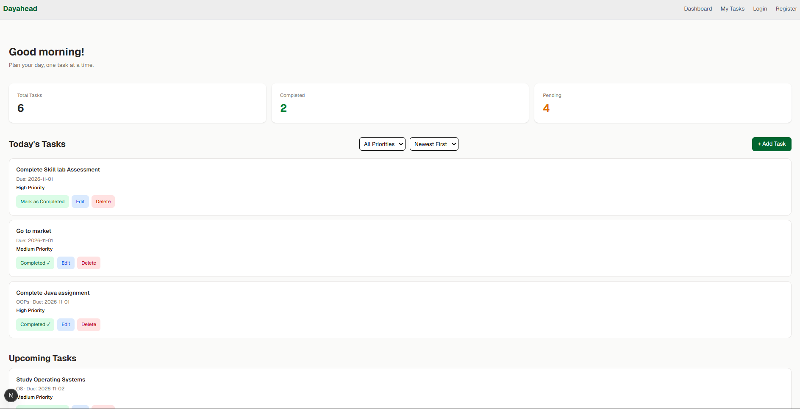
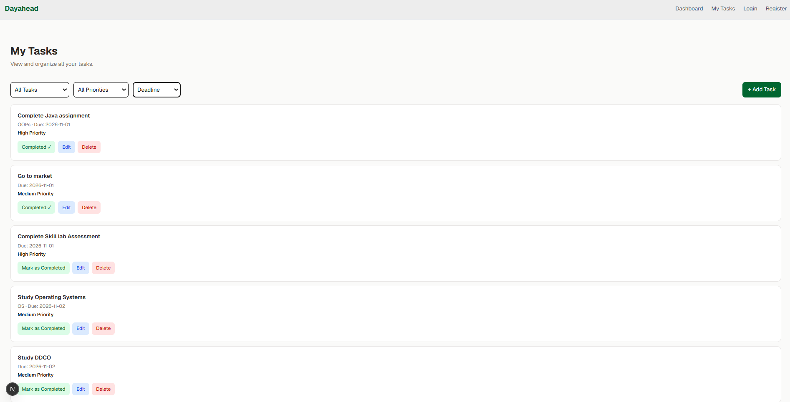
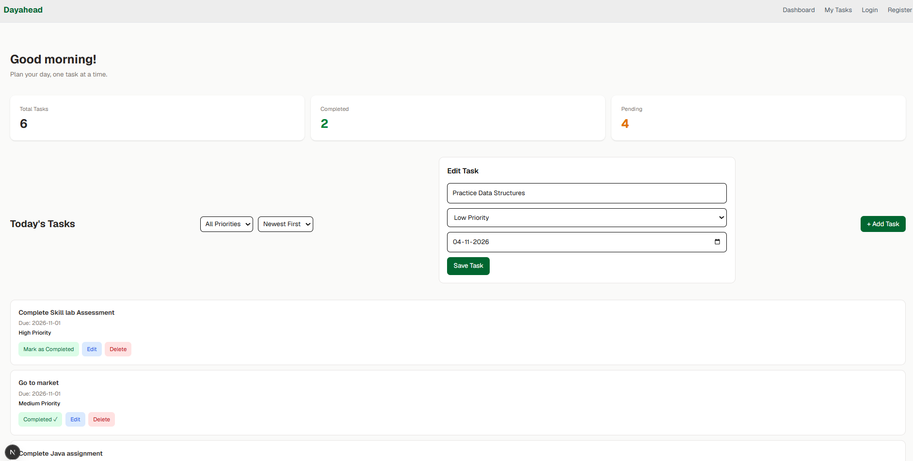
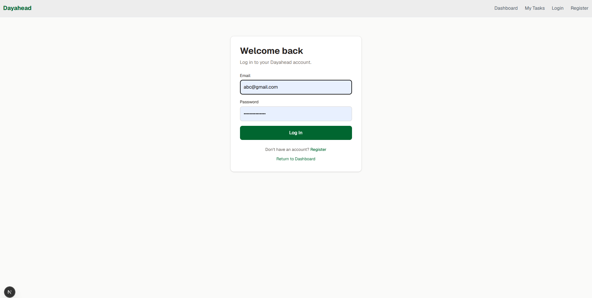
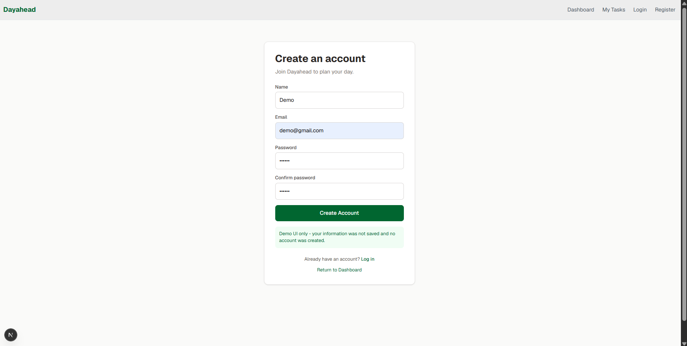

# Dayahead
### Plan today. Prepare for tomorrow.

Dayahead is a personal task and time-management planner designed to help users organize daily activities, manage priorities, and keep track of deadlines in one place.

It provides a simple dashboard where users can plan their day, review upcoming tasks, and manage their workload efficiently.

---

## 📸 Screenshots

### Dashboard
<!-- Replace the placeholder below with your dashboard screenshot -->


### My Tasks
<!-- Replace the placeholder below with your My Tasks screenshot -->


### Add / Edit Task
<!-- Replace the placeholder below with your task form screenshot -->


### Login
<!-- Replace the placeholder below with your login screenshot -->


### Registration
<!-- Replace the placeholder below with your registration screenshot -->


---

## ✨ Features

- **Task Dashboard** — View daily tasks and task summaries.
- **Task Management** — Add, edit, complete, and delete tasks.
- **Priority Levels** — Organize tasks as High, Medium, or Low priority.
- **Deadlines** — Assign deadlines to tasks.
- **Filtering and Sorting** — Filter tasks by priority and sort them by deadline or creation time.
- **Today's Tasks** — View overdue and current-day tasks.
- **Upcoming Tasks** — See future tasks before their deadlines arrive.
- **My Tasks** — View and manage the complete task list.
- **Login and Registration UI** — Frontend forms with basic validation.
- **Responsive Design** — Designed to work across desktop and mobile screen sizes.

---

## 🛠️ Tech Stack

| Technology | Purpose |
|---|---|
| Next.js | React framework and page routing |
| JavaScript | Application logic |
| React | Component-based UI |
| React Context | Shared task state |
| Tailwind CSS | Styling and responsive design |
| Dummy Data | Sample tasks for the frontend demo |

---

## 🚀 Getting Started

### Prerequisites

Make sure you have installed:

- [Node.js](https://nodejs.org/)
- npm

### Installation

1. Clone the repository:

   ```bash
   git clone https://github.com/thushara-bajimar/Dayahead.git
   ```

2. Navigate to the project directory:

   ```bash
   cd Dayahead
   ```

3. Install dependencies:

   ```bash
   npm install
   ```

4. Start the development server:

   ```bash
   npm run dev
   ```

5. Open [http://localhost:3000](http://localhost:3000) in your browser.

---

## 📂 Project Structure

```text
Dayahead/
├── app/
│   ├── layout.js
│   ├── page.js
│   ├── tasks/
│   │   └── page.js
│   ├── login/
│   │   └── page.js
│   └── register/
│       └── page.js
├── components/
│   ├── TaskCard.js
│   ├── TaskForm.js
│   └── SummaryCard.js
├── context/
│   └── TaskContext.js
├── public/
├── screenshots/
├── package.json
└── README.md
```

---

## 🎯 Project Objective

The objective of Dayahead is to provide a simple and accessible planner that helps users:

- Organize daily responsibilities.
- Identify important tasks.
- Keep track of deadlines.
- Prepare for upcoming work.
- Review and manage unfinished tasks.

---

## 🔮 Future Enhancements

- Persistent task storage
- User authentication
- Notifications and reminders
- Calendar integration
- Task sharing and collaboration

---

## 👩‍💻 Developed By

**Thushara B S**  
Skill Lab — Milestone 1  
B.E. Computer Science and Engineering
